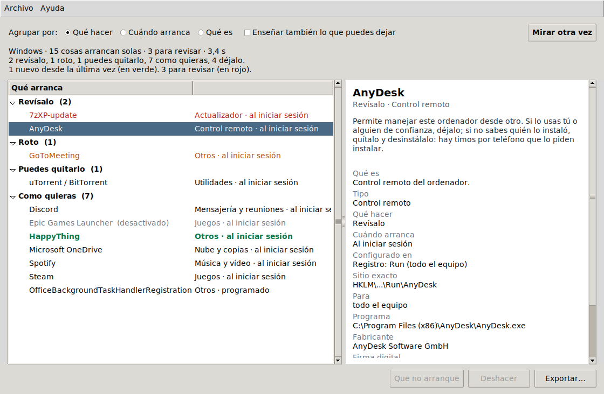
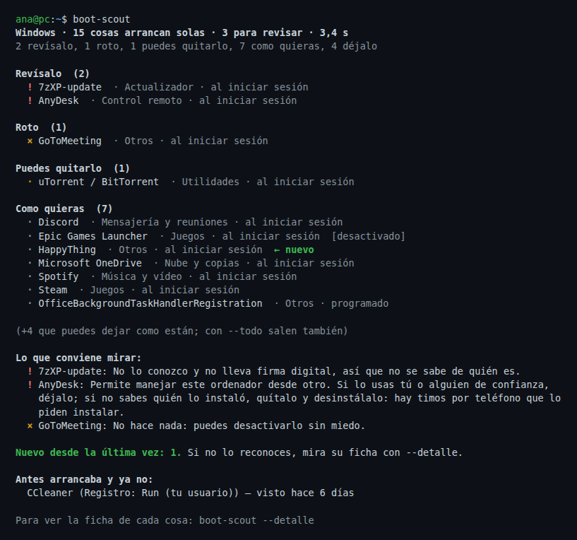

# boot-scout

[](https://github.com/espi0207/boot-scout/actions/workflows/ci.yml)
[](https://github.com/espi0207/boot-scout/actions/workflows/release.yml)

**Lo que arranca con tu PC.** boot-scout busca todo lo que se pone en marcha solo al
encender el ordenador —programas, servicios, tareas programadas, lo que sea— mirando en
todos los rincones donde se puede dejar programado un arranque, y te dice en cristiano
**qué es cada cosa** y **si hace falta que arranque**. Es como la pestaña Inicio del
Administrador de tareas, o como Autoruns, pero explicado para cualquiera.

Y se acuerda de lo que vio la última vez, así que te avisa de lo **nuevo**: algo que
empieza a arrancar solo de repente suele ser un programa que acabas de instalar… o algo
que no querías.



boot-scout **solo mira**. No cambia nada salvo que tú le pidas desactivar algo, y siempre
se puede deshacer. Y solo toca cosas de tu usuario: lo del sistema te dice cómo cambiarlo,
pero no lo hace él.

## Descargar

| Sistema | |
|---|---|
| **Windows** 10 y 11 | [Instalador (boot-scout-windows.exe)](https://github.com/espi0207/boot-scout/releases/latest/download/boot-scout-windows.exe) |
| **macOS** 11 o posterior, con chip de Apple | [boot-scout-mac.dmg](https://github.com/espi0207/boot-scout/releases/latest/download/boot-scout-mac.dmg) |
| **Linux** (Ubuntu, Debian, Mint...) | [boot-scout-linux.deb](https://github.com/espi0207/boot-scout/releases/latest/download/boot-scout-linux.deb) |

No están firmados, porque firmar cuesta dinero cada año. Por eso la primera vez el
sistema avisa:

- **Windows** dice "Windows protegió su PC". Pulsa *Más información* y luego *Ejecutar de
  todas formas*.
- **macOS**: arrastra boot-scout a Aplicaciones y ábrelo. Dirá que no puede comprobar si
  es seguro; ve a *Ajustes del Sistema > Privacidad y seguridad*, baja hasta el aviso y
  pulsa *Abrir igualmente*.
- **Linux**: `sudo apt install ./boot-scout-linux.deb`. Sale en el menú, y en la terminal
  como `boot-scout`.

Al abrirlo mira tu ordenador solo, en un par de segundos. Si quieres verlo sin tocar nada:
*Archivo > Ver un ordenador de ejemplo*.

Los tres se construyen y se prueban en GitHub Actions: la CI instala cada uno y comprueba
que abre, agrupa y exporta.

## En la terminal

Lo mismo sin ventana. Con Python 3.10 o más nuevo (no usa ninguna librería):

```bash
pipx install git+https://github.com/espi0207/boot-scout
```



(Es el ordenador de ejemplo de `boot-scout --demo`.)

```bash
boot-scout                 # todo lo que arranca, agrupado por "qué hacer"
boot-scout --detalle       # la ficha completa de cada cosa
boot-scout --todo          # enseñar también lo que puedes dejar como está
boot-scout --revisar       # solo lo que conviene mirar
boot-scout --agrupar cuando   # agrupar por cuándo arranca (o: tipo)
boot-scout --tipo juegos   # solo de un tipo
boot-scout --json cosas.json  # guardarlo todo (con - lo saca por pantalla)

boot-scout --desactivar "Spotify"   # que algo tuyo deje de arrancar (reversible)
boot-scout --activar "Spotify"      # volver a activarlo
boot-scout --deshacer               # deshacer el último cambio

boot-scout --demo          # un ordenador de ejemplo, sin mirar el tuyo
```

## Dónde mira

La idea es no dejarse ningún rincón: hay muchos sitios donde un programa puede pedir
arrancar solo, y el malware se esconde justo en los menos conocidos.

### Windows

| Dónde | Qué es |
|---|---|
| Claves **Run** del registro | `Run`, `RunOnce`, `RunOnceEx` y las de políticas, en tu usuario (HKCU) y en todo el equipo (HKLM), incluidas las de 32 bits (`Wow6432Node`). El estado activado/desactivado sale de `StartupApproved`, igual que en el Administrador de tareas. |
| Carpetas de **Inicio** | La tuya y la común. Lee los accesos directos `.lnk` (sin Windows: el formato es público), y también `.exe`, `.bat`, `.vbs`, `.ps1`… |
| **Tareas programadas** | Los XML de `C:\Windows\System32\Tasks`: al arrancar, al iniciar sesión, a una hora, cada x tiempo… con su estado y su autor. |
| **Servicios** | Los de arranque automático (`Start=2`), con su cuenta y si arrancan con retraso. Los controladores, solo si los pides. |
| **Winlogon** (`Shell`, `Userinit`), **Active Setup**, **AppInit_DLLs** y los depuradores de **IFEO** | Rincones poco conocidos por donde se cuela el malware: si hay algo raro ahí, boot-scout lo marca. |

### macOS

| Dónde | Qué es |
|---|---|
| **launchd** | Los *agentes* (arrancan al iniciar sesión) y *daemons* (arrancan con el Mac), tuyos, de otras apps y de Apple. Lee los `.plist` y saca cuándo arrancan de verdad (al cargar, cada x tiempo, a una hora, cuando cambia algo…) y si están activados. |
| **Elementos de inicio de sesión** | Los de *Ajustes > General > Elementos de inicio*, con `sfltool dumpbtm`. |
| **cron** y **perfiles de shell** | Lo que quede ahí. |

### Linux

| Dónde | Qué es |
|---|---|
| **Autostart del escritorio** | `~/.config/autostart` y `/etc/xdg/autostart` (archivos `.desktop`). |
| **systemd** | Servicios y temporizadores habilitados, tuyos (`--user`) y del sistema, con su descripción y lo que ejecutan. |
| **cron** | El tuyo, `/etc/crontab`, `/etc/cron.d` y las carpetas `cron.{hourly,daily,weekly,monthly}`, incluidas las tareas `@reboot`. |
| **rc.local** y **perfiles de shell** | `/etc/rc.local` y las líneas de `~/.bashrc`, `~/.profile`, `/etc/profile.d`… que lancen algo en segundo plano. |

De cada cosa, boot-scout averigua qué archivo se ejecuta **de verdad** (si es un
`rundll32`, la DLL que carga; si es un `powershell -EncodedCommand`, descodifica el código
para enseñártelo; si es un acceso directo, a qué apunta; si se abre en una terminal, el
programa de dentro), si ese archivo **existe**, su **versión y fabricante**, y su **firma
digital**. En Linux, en vez de la firma, mira **de qué paquete viene** (preguntando a dpkg,
rpm o pacman, y reconociendo las apps snap y flatpak).

## Cómo lo clasifica

Cada cosa sale ordenada en tres ejes:

- **Cuándo arranca**: al encender, al iniciar sesión, programado, cuando lo pide algo,
  dentro de otros programas, o configuración del sistema.
- **Qué es**: actualizador, hardware y controladores, antivirus, nube y copias, mensajería,
  juegos, control remoto, utilidades, parte del sistema, programación, navegador, VPN…
- **Qué hacer**, en palabras normales:
  - **Déjalo**: hace falta (un controlador, el antivirus, un actualizador de seguridad).
  - **Como quieras**: funciona igual si lo abres tú cuando lo necesites (Spotify, Steam,
    Discord…). Solo pierdes que esté listo desde el principio; ganas memoria y arranque.
  - **Puedes quitarlo**: no aporta nada arrancando solo (un uTorrent que sigue
    compartiendo en segundo plano, un limpiador que solo muestra avisos).
  - **Revísalo**: conviene que mires qué es (control remoto que no recuerdas instalar,
    algo sin firma en una carpeta temporal, un rincón del sistema con algo raro).
  - **Roto**: apunta a un archivo que ya no existe; no hace nada y puedes quitarlo.

boot-scout conoce ~180 programas y servicios comunes y, para el resto, decide por la firma,
la ruta y lo que el archivo dice de sí mismo. En Linux, por el paquete: si lo pone a arrancar
un paquete del sistema, déjalo; si es un programa instalado que tú (o él mismo) has puesto a
arrancar, como quieras. Y la sección del paquete (red, sonido, juegos, programación…) dice
qué es. Y marca lo que no cuadra: una firma no válida, algo
metido en una carpeta temporal, o un sitio del sistema (Winlogon, IFEO) con algo que no
debería estar.

## Limitaciones

- **No es un antivirus.** Que algo salga en "Revísalo" no quiere decir que sea malo:
  quiere decir que boot-scout no lo conoce y conviene que mires qué es. Y que no lo marque
  no garantiza que sea inofensivo.
- **Lo que no he probado en un Windows ni un Mac de verdad.** El grueso está desarrollado y
  probado en Linux, y los módulos de Windows y macOS se prueban con datos de muestra
  (registros, XML de tareas, accesos directos `.lnk` y `.plist` reales), más una pasada de
  verdad en los runners de Windows y macOS de la CI en cada cambio. Pero cada ordenador es
  un mundo; si algo sale raro en el tuyo, abre un issue con lo que diga `boot-scout
  --detalle` de esa entrada.
- **La firma digital** (Windows/macOS) tarda un poco por entrada, porque la comprueba el
  sistema. Si no se puede comprobar, boot-scout no la enseña en vez de inventarse una.
- **Cosas del sistema.** Algunas, en Windows, solo se ven o se cambian con permisos de
  administrador. boot-scout las muestra y dice cómo cambiarlas, pero no las toca.
- **Desactivar solo lo tuyo.** boot-scout desactiva cosas de tu usuario (y lo deshace).
  Lo del sistema (servicios, agentes del sistema) te dice dónde cambiarlo a mano, porque
  tocarlo mal puede dejar el ordenador peor.
- **No busca malware activamente** ni mira todos los rincones imaginables (suscripciones
  WMI, algunos sitios muy raros): mira los que de verdad usan los programas y por donde se
  cuela lo malo más a menudo.

## Cómo está hecho

Python sin librerías: el registro de Windows con `winreg`, los `.lnk` y los XML de tareas
a mano, los `.plist` con `plistlib`, y la ventana con Tkinter (viene con Python).

| Archivo | Qué hace |
|---|---|
| [`cmdline.py`](bootscout/cmdline.py) | De una orden de arranque al archivo real (comillas, variables, `rundll32`, `powershell`, envoltorios…) |
| [`lnk.py`](bootscout/lnk.py) | Leer accesos directos de Windows sin Windows |
| [`scan_windows.py`](bootscout/scan_windows.py) · [`win_services.py`](bootscout/win_services.py) · [`win_tasks.py`](bootscout/win_tasks.py) | Los rincones de Windows |
| [`scan_macos.py`](bootscout/scan_macos.py) · [`scan_linux.py`](bootscout/scan_linux.py) | launchd/login items y autostart/systemd/cron |
| [`known.py`](bootscout/known.py) | Los programas conocidos: qué son y qué hacer con ellos |
| [`judge.py`](bootscout/judge.py) | Decide tipo y veredicto de cada cosa |
| [`apply.py`](bootscout/apply.py) | Activar/desactivar lo tuyo, reversible |
| [`history.py`](bootscout/history.py) | Lo que recuerda de una vez a otra |

Lo que viene de fuera se trata con cuidado: órdenes y nombres se leen, nunca se ejecutan;
los XML y los `.lnk` mal formados se descartan sin romper; el código embebido de
PowerShell se descodifica **solo para enseñarlo**; y los nombres se limpian de caracteres
de control antes de salir por la terminal. boot-scout recuerda lo que ha visto en un JSON
en tu carpeta de datos (`%APPDATA%`, `~/Library/Application Support` o `~/.local/share`,
o en `BOOTSCOUT_HOME` si existe esa variable).

### Pruebas

```bash
pip install -e ".[dev]"
pytest
```

Más de cien pruebas: los formatos de cada sistema (registro, StartupApproved, XML de
tareas en UTF-16 y UTF-8, `.lnk`, `.plist`, crontabs, `.desktop`, lo que contestan dpkg, rpm
y pacman), los casos raros y rotos,
la clasificación, el historial, desactivar y deshacer de verdad (con archivos reales en
Linux), la terminal y la ventana.

## Licencia

MIT.
